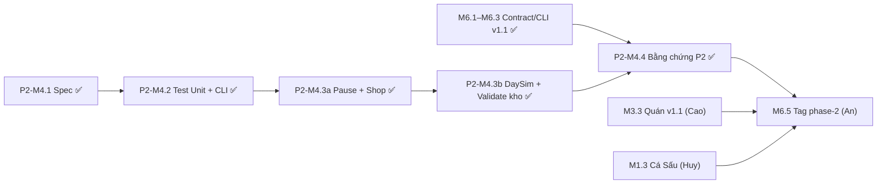
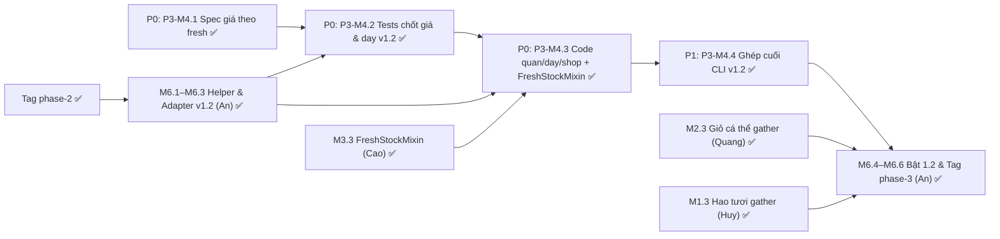
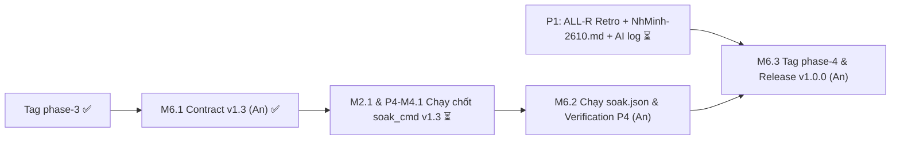

# Bảng theo dõi tiến độ toàn dự án — M4 (`NhMinh-2610`)

- **Phụ trách:** Nguyễn Nhật Minh (`NhMinh-2610`) · **Module:** M4 (Dev · dự phòng & review chéo M3 `ththanh8888`)
- **Nhánh làm việc:** `NguyenNhatMinh` *(đã merge `main` tại `d413708` — có tag `phase-3` và Contract `v1.3`)*

---

## 1. Tổng quan 4 Phase

| Phase | Khung giờ | Hạn tag | Việc của M4 | Tiến độ | Trạng thái hiện tại |
|---|---|---|---|---|---|
| **Phase 1** | 0:00–1:00 | `phase-1` | `sim/quan` (bếp, bàn, bưng, tiền, tip, uy tín, hết ca) + ghép M3 | **100%** | ✅ Đã gắn tag `phase-1` |
| **Phase 2** | 1:00–1:55 | `phase-2` | `day`, `Shop`, `Pause` 3 mode *(+ tùy chọn `burn`)* | **100%** | ✅ Đã gắn tag `phase-2` |
| **Phase 3** | 1:55–2:30 | `phase-3` | Độ tươi v1.2: giá `floor(giá × avg_fresh/100)`, `cook_started.items` cá thể, kho cá thể trong `day`/Shop *(+ tùy chọn `reservations`)* | **100%** | ✅ Đã gắn tag `phase-3` (`5d69601`, 160/160 active tests OK) |
| **Phase 4** | 2:30–3:00 | `phase-4` + `v1.0.0` | Bot tất định cho `soak_cmd` 10 Ngày (cùng Quang M2), Retro & chốt báo cáo *(+ tùy chọn `leaderboard`)* | **100%** | ✅ Đã chốt `soak.json` v1.3 (`10/10` ngày, `0` crash), Retro & `NhMinh-2610.md`; chỉ còn push & mở PR vào `main` |

---

## 2. Danh sách các task Phase 4 (trước 2:55)

### Bắt buộc (đã hoàn thành trên nhánh `NguyenNhatMinh`)
- [x] **Bước 1 — Đồng bộ nhánh:** Đã merge `main` (`d413708`: tag `phase-3`, `contract_version: "1.3"`, `bench_cmd`/`soak_cmd`) vào `NguyenNhatMinh`.
- [x] **Bước 2 — `P4-M4.1` (Chốt `soak_cmd` trên `v1.3`):**
  - Đã chạy `python -m chonoi.soak --seed 7 --days 10 --out docs/proof/phase-4/soak.json` lặp 2 lần (`days_completed == 10`, `crashes == 0`, lặp `D1–D5` cho `D6–D10`, `results[]` giống hệt nhau).
  - Đã chạy xanh `tools/check_team.py` và toàn bộ 160/160 active tests trên `v1.3`.
- [x] **Bước 3 — `ALL-R` (Retro & hồ sơ cuối dự án):**
  - Đã điền mục **Phase 4 (cuối)** trong `docs/retro.md`.
  - Đã chốt phản tư cá nhân `docs/members/NhMinh-2610.md` (≤ 200 từ, đủ hash commit P1–P4).
  - Đã cập nhật `docs/ai-usage-log.md` cho Phase 4.
- [ ] **Thao tác bàn giao của Minh:** Push nhánh `NguyenNhatMinh`, mở PR vào `main` và báo An (`M6.3`) gắn tag `phase-4` & công bố GitHub Release `v1.0.0`.

### Tùy chọn (Mở rộng — chỉ làm nếu nhóm chốt cần thêm)
- [ ] **`leaderboard` (Phase 4):** Lưu top 10 lượt chuẩn 5 Ngày cục bộ (`--export-leaderboard`, `--leaderboard` + `--player-name` trong `day`, thiếu cờ/sai mode → mã `2`, `soak` không ghi xếp hạng). *(Nhóm đã có Phụ đề SFX của M5; chỉ làm nếu nhóm cần đủ 2 mục Mở rộng.)*
- *(Các mở rộng Phase cũ không bắt buộc: `burn` P2, `reservations` P3.)*

---

## 3. PHASE 1 — `sim/quan` (`0:00–1:00 · v1.0`) ✅ ĐÃ XONG

- [x] **M4.1** — Chốt Spec & 8 AC (`AC-M4-01` → `AC-M4-08`).
- [x] **M4.2** — Viết bộ test `tests/test_quan_m4.py` (12 test hộp đen & unit).
- [x] **M4.3** — Cài đặt bếp, bàn, bưng, tiền, tip, uy tín, hủy món mồ côi, hết ca trong `chonoi/sim/quan.py`.
- [x] **M4.4** — Ghép `CustomerMixin` của M3 (`quan_customers.py`), chạy xanh toàn bộ test + lưu bằng chứng `docs/proof/phase-1/m4-test-log.txt`.
- [x] **Quy trình P1** — Đủ ≥ 3 commit (`NhMinh-2610`), merge `main` (PR #1 & #3), điền `docs/standup.md`, `docs/ai-usage-log.md`, `docs/members/NhMinh-2610.md`, `tools/check_team.py` xanh.
- [x] **Chốt cuối P1:** Review chéo với Cao (`ththanh8888`), An (`K0heii`) đã chốt `verification/phase-1.md` và gắn tag `phase-1`.

---

## 4. PHASE 2 — `day`, `Shop`, `Pause` (`1:00–1:55 · v1.1`) ✅ XONG PHẦN M4

### Sơ đồ phụ thuộc gọn

### Đã hoàn thành (26/26 test M4 + CLI hộp đen v1.1 xanh)
- [x] **P2-M4.1** — Chốt Spec & `AC-P2-M4-01` → `AC-P2-M4-09` tại `docs/plan/spec-p2-m4.md`.
- [x] **P2-M4.2** — Viết `tests/test_day_shop_pause_m4.py` (6 unit test + 4 CLI black-box test trên `game.contract.json` v1.1: `--mode day --days 1|2`, Pause 3 mode, tất định từng byte, mã thoát `2` khi kho thực mâu thuẫn).
- [x] **P2-M4.3a** — Cài Pause (`paused`/`resumed`, `state:"paused"`) trong `chonoi/runner.py` và `ShopSim` trong `chonoi/sim/shop.py`.
- [x] **P2-M4.3b** — Cài `DaySim` trong `chonoi/sim/day.py` (`day_start → day_plan → gather → quan → shop → ngày kế`, kho trong bộ nhớ, lọc `day_plan`, kiểm `validate_quan_stock` lúc mở quán, áp `active_upgrades` từ Ngày kế).
- [x] **Regression P1** — Cập nhật tọa độ test ngoài mép ở `test_ac_m4_01` (`[3.51, 8]` → `[0.49, 8]`) do v1.1 thêm bếp `B2 [5, 8]`.
- [x] **P2-M4.4 (bằng chứng & log)** — Lưu bằng chứng `docs/proof/phase-2/m4-test-log.txt`, cập nhật `docs/standup.md` và `docs/ai-usage-log.md`.

### Việc còn lại (chờ đồng đội / tùy chọn)
- [x] Ghép kiểm chung với **Huy (`M1.3` Cá Sấu)**: truyền `day=self.day` vào `GatherSim` (Ngày 3 sinh đủ `M1`, `M2`) & test ngất do Cá Sấu trong `day` vẫn mở quán kho rỗng.
- [x] Ghép kiểm chung với **Cao (`M3.3` / `M3.4`)**: merge `c7a8797`, chạy xanh **110/110 test** toàn bộ M1 + M2 + M3 + M4 + M6.
- [x] Điền **retro nhanh Phase 2** (`docs/retro.md`) & cập nhật `docs/members/NhMinh-2610.md`.
- [ ] *(Tùy chọn nếu muốn làm mở rộng)* **Mở rộng `burn`** (Cháy món `burn_s: 20`, `ready_ticks > 1200` → `dish_burnt`) cùng M3/M6.

---

## 5. PHASE 3 — Độ tươi & Kho cá thể (`1:55–2:30 · v1.2 — Mùa Nước Nổi`) ✅ ĐÃ XONG & GẮN TAG `phase-3`

> **Lưu ý Breaking Change (`phase-3-task.md` & `Ticket03.md`):** Đổi kho đếm sang kho cá thể `{"items":[{"id":"I1","kind":"...","fresh":100}]}` (v1.2 từ chối kho đếm mã `2`). Dùng chung đơn vị nguyên (`fresh_units = fresh × 240`, trừ 2/tick ở gather và 1/tick ở quán) để tránh sai số float ở ngưỡng `30` và phép `floor`.

### Phụ thuộc Phase 3

- [x] **P3-M4.1** *(đã lưu tại `docs/plan/spec-p3-m4.md`)*: Chốt Spec/AC cho chốt giá theo `avg_fresh`, boa trên giá đã chốt, `cook_started.items` sắp `(kind, id)`, bàn giao kho cá thể trong `day`/Shop.
- [x] **P3-M4.2**: Viết `tests/test_freshness_m4_v12.py` phủ đủ `AC-P3-M4-01` → `AC-P3-M4-07`.
- [x] **P3-M4.3** (`53b8301` → merge `main` `94c15f7`): Nối hoàn chỉnh `chonoi/sim/quan.py` với `FreshStockMixin` của M3.3; `chonoi/sim/day.py` & `chonoi/sim/shop.py` bàn giao kho qua `stock_items_out()`, Shop không hao tươi.
- [x] **P3-M4.4 & Tag `phase-3`** (`5d69601`): Lưu `docs/proof/phase-3/m4-test-log.txt`; An (`M6`) đã bật `"contract_version": "1.2"`, chạy xanh 160/160 active tests và gắn tag `phase-3`.
- [ ] *(Tùy chọn, không bắt buộc)* **Mở rộng `reservations`** (Khách đặt trước `R1, R2` mỗi Ngày, giá `×1.5`, lỡ đơn uy tín `-1`).

---

## 6. PHASE 4 — Soak, Đóng gói & Phát hành `v1.0.0` (`2:30–3:00 · v1.3`) 🟡 ĐANG CHỐT CUỐI

> **Lưu ý (`phase-4-task.md` & `Ticket04.md`):** Gameplay/tuning/kho/JSONL giữ nguyên theo `v1.2`; `main` (`d413708`) đã nâng `contract_version: "1.3"` và khai báo `bench_cmd: "python3 -m chonoi.bench"`, `soak_cmd: "python3 -m chonoi.soak"`.

### Phụ thuộc Phase 4

### Đã làm sẵn ở Phase 4
- [x] **P4-M4.1 (phần code & unit test):** Đã tạo `chonoi/soak.py` + `tests/test_soak_m4.py` và bổ sung lặp `D1–D5` cho `D6–D10` trong `DaySim._get_plan()` (xuất đủ `days, days_completed, crashes, results[], duration_s`).

### Cần làm để chốt Phase 4 (trước 2:55)
- [x] **Merge `main` (`d413708`)** vào `NguyenNhatMinh` để nhận `game.contract.json` `v1.3`, `docs/plan/phase-4.md` và `docs/verification/phase-4.md`.
- [x] **P4-M4.1 (chạy chốt trên `v1.3`):**
  - Chạy `python -m chonoi.soak --seed 7 --days 10 --out docs/proof/phase-4/soak.json` (lặp 2 lần: `days_completed == 10`, `crashes == 0`, `results[]` khớp nhau trên kho cá thể `v1.3`).
  - Chạy xanh `tests/test_soak_m4.py`, `tools/check_team.py` và regression P1–P3 trên `v1.3`.
- [x] **ALL-R (Retro & chốt hồ sơ cá nhân):**
  - Đã điền phần **Phase 4 (cuối)** trong `docs/retro.md`.
  - Đã chốt `docs/members/NhMinh-2610.md` (≤ 200 từ, dẫn đủ hash commit P1–P4).
  - Đã cập nhật `docs/ai-usage-log.md` cho Phase 4.
- [ ] **Thao tác bàn giao của Minh:** Push nhánh `NguyenNhatMinh`, mở PR vào `main` trước **2:55** để An (`M6.3`) gắn tag `phase-4` & công bố Release `v1.0.0`.
- [ ] *(Tùy chọn nếu nhóm cần đủ 2 Mở rộng)* **Mở rộng `leaderboard`**: lưu top 10 lượt chuẩn 5 Ngày cục bộ, `<run_cmd> --export-leaderboard`, cờ `--leaderboard` + `--player-name` trong `day` (thiếu 1 cờ hoặc sai mode → mã `2`), không đổi JSONL, `soak` không ghi xếp hạng.
