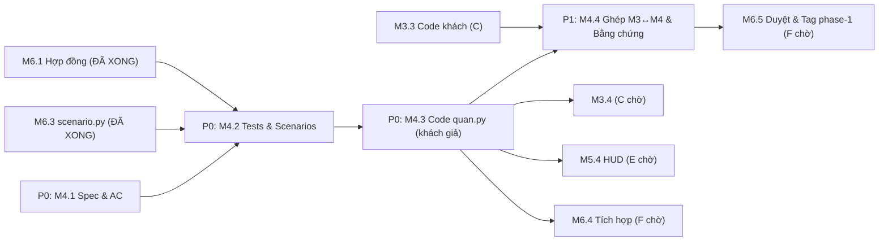
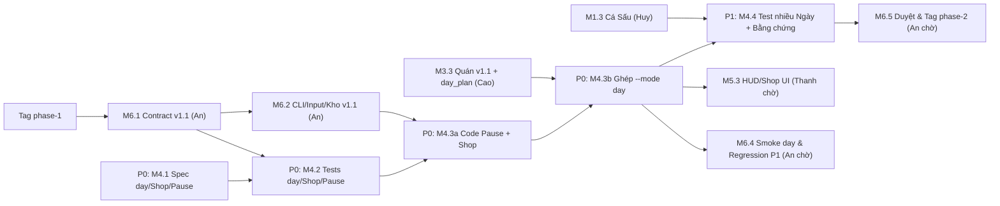

# Kế hoạch & Checklist tiến độ toàn dự án — M4 (D): Nguyễn Nhật Minh (`NhMinh-2610`)

- **Phụ trách:** Nguyễn Nhật Minh (`NhMinh-2610`) — Vai: Dev (dự phòng & review chéo với M3 `ththanh8888`)
- **Phạm vi xuyên suốt:**
  - **Phase 1:** Bếp, Bàn, Bưng, Tiền, Boa (Tip), Uy tín, Hết ca trong `chonoi/sim/quan.py`
  - **Phase 2:** Vòng ngày `--mode day`, Shop (`oxygen`/`hp`), Pause (`paused`/`resumed`), tùy chọn mở rộng `burn`
  - **Phase 3 & Phase 4:** Cập nhật theo ticket từng mốc (1:55 & 2:30)
- **Tài liệu chuẩn:** `README.md`, `PRD0.md`, `Ticket02.md`, `phase-1-task.md`, `phase-2-task.md`, `docs/contracts/README.md`, `docs/clarify.md`, `game.contract.json`

## Tổng quan tiến độ 4 Phase

| Phase | Mốc giờ | Hạn tag | Trọng tâm của M4 | Trạng thái |
|---|---|---|---|---|
| **Phase 1** | 0:00–1:00 | `phase-1` (1:00) | `sim/quan` (Bếp, Bàn, Bưng, Tiền, Tip, Uy tín, Hết ca) + ghép M3 | ✅ Xong code & 68/68 test (chờ merge PR & tag) |
| **Phase 2** | 1:00–1:55 | `phase-2` (1:55) | `--mode day`, Shop (`oxygen`/`hp`), Pause 3 mode (+ tùy chọn `burn`) | 🟡 Đã xong lõi `ShopSim`/`DaySim`/Pause + 6 unit test (chờ `M6.1`/`M6.2` nối CLI) |
| **Phase 3** | 1:55–2:30 | `phase-3` (2:30) | *Cập nhật khi mở đề Phase 3* | 🔜 Chưa mở |
| **Phase 4** | 2:30–3:00 | `phase-4` + `v1.0.0` (3:00) | *Hoàn thiện, đóng gói, tài liệu, demo* | 🔜 Chưa mở |

---

## PHASE 1 — `sim/quan` (`0:00–1:00 · Test Contract v1.0`)

### 1. Thứ tự ưu tiên & sơ đồ phụ thuộc (Phase 1)

> **Hiện trạng:** `M6.1`, `M6.2`, `M6.3` đã xong trên `main` → **M4.1 → M4.2 → M4.3 có thể làm liên tục ngay bây giờ** (chỉ chờ M3 ở bước ghép `M4.4`).

| Ưu tiên | Mã task | Mục tiêu | Phụ thuộc (Chờ) | Ai chờ mình | Trạng thái |
|---|---|---|---|---|---|
| **P0 (Làm ngay)** | **M4.1** | Chốt Spec/AC + giao ước interface với M3 | Không | `M4.2` | Đã xong (chờ xác nhận nhanh với M3) |
| **P0 (Sau M4.1)** | **M4.2** | Viết bộ test `tests/test_quan_m4.py` | `M4.1`, `M6.1` ✅, `M6.3` ✅ | `M4.3` | Đã xong ✅ |
| **P0 (Trọng tâm)** | **M4.3** | Code phần M4 trong `chonoi/sim/quan.py` (chạy độc lập với khách từ scenario) | `M4.2` | `M3.4`, `M4.4`, `M5.4`, `M6.4` | Đã xong ✅ |
| **P1 (Trước 0:45)** | **M4.4** | Ghép M3 ↔ M4, chạy full test, lưu bằng chứng | `M4.3`, `M3.3` (C) ✅ | `M6.5` | Đã xong ✅ |
| **P2 (Xuyên suốt)** | **Quy trình** | ≥ 3 commit, review chéo C ↔ D, nhật ký AI & standup | Song song | DoD Phase 1 | Đang tiến hành |

---

## 2. Checklist chi tiết theo thứ tự làm

### Đợt 1 — `M4.1`: Spec, AC & chốt giao ước với M3 *(Ưu tiên P0 — làm đầu tiên)*
- [x] Đối chiếu lại toàn bộ số liệu trong `game.contract.json` (`interact_radius`, `eat_s`, `patience_s`, `burn_s`, `carry_limit`, `tip_rate`, `tip_min_patience_ratio`, `tip_reputation`, `left_reputation_delta`, `reputation_min/max`, `menu`).
- [x] Chốt danh sách `AC-M4-01` → `AC-M4-08` (xem mục 3 bên dưới).
- [ ] Nhắn trao đổi nhanh với **M3 (`ththanh8888`)** để thống nhất:
  - [x] Cấu trúc dict `customer` trong `self.customers` (đủ 11 trường theo `docs/contracts/README.md`).
  - [x] Tách vùng hàm trong `chonoi/sim/quan.py` để tránh conflict merge (M3 giữ khách/lịch/spawn; M4 giữ bếp/interact/tiền/tip/dọn cuối ca).
  - [x] Hàm dùng chung `_cleanup_order_artifacts(order_id)` và `_add_reputation(delta)` khi khách bỏ đi vì hết kiên nhẫn.
- [x] Commit 1 (`M4.1`): lưu spec/kế hoạch (`docs/plan/phase-1-Minh.md`).

---

### Đợt 2 — `M4.2`: Viết bộ test từ AC *(Ưu tiên P0 — làm ngay sau M4.1)*
- [x] Tạo file `tests/test_quan_m4.py` dùng `scenario` dựng sẵn khách (độc lập với M3).
- [x] Viết test cho `AC-M4-01`: chọn mục tiêu `interact` đúng mép `interact_radius`, thứ tự ưu tiên `(dist, bếp trước bàn, id_key)`, bỏ lượt khi đối tượng chọn không tương tác được.
- [x] Viết test cho `AC-M4-02`: `cook_started` chọn đơn `reserved` cũ nhất theo `(order_tick, id_key(table_id))`, trừ đúng kho, `items` sắp theo `kind`, cập nhật `reserved = {}`, `order_status = "assigned"`.
- [x] Viết test cho `AC-M4-03`: `dish_ready` sau đúng `cook_s * 60` tick, `ready_ticks == 0` ở tick vừa chín rồi mới tăng từ tick sau, `burn_s: null` không cháy.
- [x] Viết test cho `AC-M4-04`: `dish_picked` khi tay trống (`carry_limit == 1`), bếp về `idle`; bỏ qua khi tay đang cầm món.
- [x] Viết test cho `AC-M4-05`: `served` đúng `order_id`, sai `order_id` bỏ qua; tính tip đúng biên `patience_ticks_left / patience_max >= tip_min_patience_ratio` (cả trường hợp đạt biên và thiếu 1 tick); phục vụ đúng tick `patience_ticks_left == 0` vẫn hợp lệ.
- [x] Viết test cho `AC-M4-06`: ăn xong sau `eat_s * 60` tick → `paid` (`finished_eating`), cộng `money`/`earned`/`shift_earned`, tip > 0 mới cộng `tip_reputation` (kẹp `[0, 5]`), kiểm tra `score = earned + 100 * floor(reputation)`.
- [x] Viết test cho `AC-M4-07`: hết ca (`time_left_ticks == 0`) → khách `eating` (kể cả vừa được phục vụ ở tick cuối) trả tiền `paid` (`closing`), khách `waiting` rời đi `customer_left` (`closing`) không trừ uy tín và hủy món mồ côi, kết thúc bằng `quan_end`.
- [x] Viết test cho `AC-M4-08`: khách `assigned` bỏ đi do hết kiên nhẫn → hủy món trên bếp (`cooking`/`ready`) hoặc `hand`, không hoàn nguyên liệu.
- [x] Chạy thử `tests/test_quan_m4.py` xác nhận fail đúng chỗ (TDD) trước khi code.
- [x] Commit 2 (`M4.2`): commit & push `tests/test_quan_m4.py` lên nhánh.

---

### Đợt 3 — `M4.3`: Code phần M4 trong `chonoi/sim/quan.py` *(Ưu tiên P0 — chặn M3.4, M4.4, M5.4, M6.4)*
- [x] Khởi tạo đầy đủ mặc định cho `customers` dựng từ `scenario` (đảm bảo chạy độc lập trước khi ghép M3: `order_tick`, `state`, `patience_ticks_left`, `eat_ticks_left`, `order_status`, tự cấp `reserved` theo công thức nếu vắng).
- [x] **Bước 1 trong `step()`:** giảm `time_left_ticks`, tăng `ready_ticks` chỉ cho bếp đã `ready` từ đầu bước, giảm `cook_ticks_left`, giảm `eat_ticks_left`, giảm `patience_ticks_left`.
- [x] **Bước 2 trong `step()`:** duyệt `stoves` theo `sort_by_id`, bếp `cooking` có `cook_ticks_left == 0` → `ready` (`ready_ticks = 0`), phát `dish_ready`.
- [x] **Bước 3 trong `step()`:** sau `self._move(inp)`, xử lý tối đa 1 cạnh lên `inp.pressed("interact")`:
  - [x] Tìm ứng viên trong `interact_radius` (`<=`), chọn theo `(dist, 0 if stove else 1, id_key(id))`.
  - [x] Implement `_cook_on_stove(stove)` → trừ `stock`, `items` sắp theo `kind`, phát `cook_started`.
  - [x] Implement `_pick_from_stove(stove)` → chuyển sang `self.hand`, reset bếp về `idle`, phát `dish_picked`.
  - [x] Implement `_serve_table(table)` → kiểm `order_id`, tính `tip` theo `patience_ticks_left` sau Bước 1, chuyển khách sang `eating`/`served`, phát `served`.
- [x] **Bước 4 trong `step()`:** duyệt khách theo `id_key(table_id)`:
  - [x] Khách `eating` có `eat_ticks_left == 0` → cộng tiền, cộng `tip_reputation` nếu `tip > 0` (kẹp `[min, max]`), phát `paid` (`finished_eating`), xóa khách.
  - [x] Helper `_cleanup_order_artifacts(order_id)` dọn bếp/tay cho đơn bị hủy.
  - [x] Helper `_add_reputation(delta)` kẹp `[reputation_min, reputation_max]`.
  - [x] Khi `time_left_ticks > 0`: xử lý khách `waiting` có `patience_ticks_left == 0` → trừ `left_reputation_delta`, dọn món mồ côi, phát `customer_left` (`patience`), xóa khách.
  - [x] Khi `time_left_ticks == 0`: dọn toàn bộ khách theo `id_key(table_id)` (`eating` → `paid` `closing`; `waiting` → `customer_left` `closing` không trừ uy tín + dọn món mồ côi), rồi phát `quan_end`.
- [x] Kiểm tra không dùng `random` toàn cục, không dùng đồng hồ hệ thống, không hard-code số liệu tuning.
- [x] Chạy xanh toàn bộ `tests/test_quan_m4.py`, `tests/test_scenario_m6.py`, `tests/test_smoke_p1.py` và `tests/test_python_starter_units.py`.
- [x] Commit 3 (`M4.3`): commit & push `chonoi/sim/quan.py` lên nhánh và báo nhóm (M3, M5, M6).

---

### Đợt 4 — `M4.4`: Ghép M3 ↔ M4 & Bằng chứng *(Ưu tiên P1 — hoàn tất trước 0:50)*
- [x] Pull / merge phần `M3.3` của Phùng Văn Thanh Cao (`ththanh8888`) vào `chonoi/sim/quan.py` (kế thừa `CustomerMixin` từ `chonoi/sim/quan_customers.py`, xử lý sạch xung đột ở `quan.py`, `standup.md`, `ai-usage-log.md`).
- [x] Kiểm tra khớp vòng đời đầy đủ: khách tự sinh (`customer_arrived`) → giữ chỗ → nấu (`cook_started`) → chín (`dish_ready`) → bưng (`dish_picked`) → phục vụ (`served`) → ăn xong (`paid`) → hết ca (`quan_end`).
- [x] Kiểm tra tính tất định (chạy cùng seed 2 lần → file JSONL giống nhau từng byte — đã kiểm trong `test_full_kitchen_loop_and_determinism`).
- [x] Chạy toàn bộ test suite (`test_quan_m4`, `test_quan_customers_m3`, `test_integration_m6`, `test_scenario_m6`, `test_smoke_p1`, `test_python_starter_units`, `test_team_check`) xanh 100% sau khi ghép M3.
- [x] Xuất bằng chứng chạy thật phần M4 + ghép M3 vào `docs/proof/phase-1/m4-test-log.txt`.
- [x] Commit 4 (`M4.4`): commit merge & push bản ghép + bằng chứng cuối.

---

### Việc ngoài bảng bắt buộc *(Ưu tiên P2 — xuyên suốt Phase 1)*
- [x] Đủ **≥ 3 commit có nội dung** bằng tài khoản GitHub `NhMinh-2610`.
- [ ] Review chéo PR/diff với **C (`ththanh8888`)** (nhận xét bám diff).
- [x] Điền dòng của mình vào `docs/standup.md` (giữa phase ~0:30).
- [x] Điền dòng của mình vào `docs/ai-usage-log.md` (cuối phase).
- [x] Kiểm tra `python tools/check_team.py` xanh.

---

## 3. Bảng kiểm nhanh Acceptance Criteria (M4)

| Mã AC | Mô tả kiểm chứng | Test | Code | Đạt |
|---|---|---|---|---|
| `AC-M4-01` | Interact đúng mép bán kính, ưu tiên `(dist, bếp trước bàn, id)`, không fallback nếu bận | [x] | [x] | [x] |
| `AC-M4-02` | `cook_started` lấy đơn `reserved` cũ nhất `(order_tick, table_id)`, trừ kho, `items` sắp theo `kind` | [x] | [x] | [x] |
| `AC-M4-03` | `dish_ready` đúng `cook_s * 60` tick, `ready_ticks = 0` ở tick chín rồi mới tăng, không cháy | [x] | [x] | [x] |
| `AC-M4-04` | `dish_picked` tôn trọng `carry_limit = 1`, bếp về `idle` | [x] | [x] | [x] |
| `AC-M4-05` | `served` đúng `order_id`, tính `tip` theo tỷ lệ kiên nhẫn sau Bước 1, hợp lệ ở tick `patience == 0` | [x] | [x] | [x] |
| `AC-M4-06` | `paid` (`finished_eating`), cộng tiền, `tip > 0` mới cộng `tip_reputation` và kẹp `[0, 5]`, đúng `score` | [x] | [x] | [x] |
| `AC-M4-07` | Hết ca: `eating` trả tiền (`closing`), `waiting` rời đi (`closing`) không trừ uy tín + hủy món, phát `quan_end` | [x] | [x] | [x] |
| `AC-M4-08` | Khách bỏ đi vì hết kiên nhẫn hủy món mồ côi trên bếp/tay, không hoàn nguyên liệu | [x] | [x] | [x] |

---

## 4. Việc cần chốt trước khi gắn tag `phase-1`

- [ ] Mở / merge PR `NguyenNhatMinh` → `main` (đã sạch conflict, 68/68 test xanh).
- [ ] Review chéo PR/diff với **C (`ththanh8888`)** và xác nhận phần ghép `M3 ↔ M4`.
- [ ] Báo **M6 (`K0heii`)** cập nhật dòng `AC-P1-M4-01` trong `docs/verification/phase-1.md` trỏ tới `docs/proof/phase-1/m4-test-log.txt`.
- [x] Tạo file phản tư cá nhân `docs/members/NhMinh-2610.md` (theo `docs/members/TEMPLATE.md`).

---

## 5. Kế hoạch & Checklist Phase 2 — M4 (`1:00–1:55 · Test Contract v1.1`)

> **Lưu ý quan trọng (từ `phase-2-task.md`):** Chỉ bắt đầu sửa code Phase 2 **sau khi M6 đã gắn tag `phase-1`** để không làm hỏng Test Contract v1.0. Riêng **Đợt 1 (`M4.1` — Spec/AC)** có thể đọc `Ticket02.md` và chuẩn bị trước ngay.

### 5.1. Sơ đồ phụ thuộc & bảng ưu tiên Phase 2

| Ưu tiên | Mã task | Mục tiêu (theo `phase-2-task.md` & `Ticket02.md`) | Phụ thuộc (Chờ) | Ai chờ mình | Trạng thái |
|---|---|---|---|---|---|
| **P0 (Làm ngay)** | **P2-M4.1** | Spec/AC cho vòng ngày `day`, Shop (`oxygen`/`hp`), Pause (`paused`/`resumed`) | Không | `P2-M4.2` | Đã xong ✅ (`docs/plan/spec-p2-m4.md`) |
| **P0 (1:05–1:20)** | **P2-M4.2** | Viết test/scenario cho `day` (1 & nhiều ngày), Shop, Pause ở cả 3 mode | `P2-M4.1`, `M6.1` | `P2-M4.3a` | Đã xong lõi unit test ✅ (bổ sung CLI sau `M6.2`) |
| **P0 (1:20–1:30)** | **P2-M4.3a** | Code Pause (`runner.py`) ở cả 3 mode + logic Shop (`oxygen`/`hp`, 600 tick) | `P2-M4.2`, `M6.2` | `P2-M4.3b` | Đã xong ✅ (`runner.py`, `shop.py`) |
| **P0 (1:30–1:38)** | **P2-M4.3b** | Ghép `--mode day` (`day_start → day_plan → gather → quan → shop → ngày kế`), chuyển kho trong bộ nhớ, áp `active_upgrades` từ Ngày kế | `P2-M4.3a`, `M3.3` (Cao) | `P2-M4.4`, `M5.3`, `M6.4` | Đã xong lõi ✅ (`day.py`, chờ `M6.2`/`M3.3` ghép cuối) |
| **P1 (1:38–1:50)** | **P2-M4.4** | Chạy test `day --days 1` & nhiều ngày (kiểm `oxygen`/`hp` hiệu lực Ngày 2) + Pause, lưu `docs/proof/phase-2/` | `P2-M4.3b`, `M1.3` (Huy) | `M6.5` | Chưa xong |
| **P2 (Tùy chọn)** | **Mở rộng `burn`** | Cháy món (`burn_s: 20`, `ready_ticks > 1200` → `dish_burnt`) cùng M3 nếu xong lõi trước 1:35 | Lõi Phase 2 xanh | README + bằng chứng | Tùy chọn |

---

### 5.2. Checklist chi tiết Phase 2

#### Đợt 1 — `P2-M4.1`: Spec & AC (`day`, Shop, Pause) *(Ưu tiên P0 — đã lưu tại `docs/plan/spec-p2-m4.md`)*
- [x] Chốt luật **Pause** (Contract v1.1 mục 4.2): xét cạnh lên `pause` trước tiên ở cả 3 mode (`gather`, `quan`, `day`); khi vào pause chỉ tăng tick ngoài, giữ nguyên `sim_tick`/`phase_tick`/timer, phát `paused`, bỏ qua hành động & `buy`; cạnh lên tiếp theo phát `resumed` và chạy gameplay ngay bước đó; snapshot có `state: "paused"`.
- [x] Chốt luật **Shop** (Contract v1.1 mục 2, 4.4, 4.5):
  - [x] Nâng cấp đọc từ `tuning.shop.upgrades`: `oxygen` (Cấp 1: 200 → 45s/2700 tick, Cấp 2: 400 → 60s/3600 tick), `hp` (Cấp 1: 250 → 4 HP, Cấp 2: 500 → 5 HP).
  - [x] Mua từng cấp kế tiếp, đủ đúng giá vẫn mua được, trừ `money` (giữ `earned` & `score`), cập nhật `upgrades` ngay nhưng chỉ có hiệu lực từ Ngày kế (`active_upgrades`).
  - [x] Lỗi mua → phát `buy_failed` với `reason` (`funds` / `max_level` / `out_of_stock` / `unknown`), tiền & cấp giữ nguyên.
  - [x] Xử lý `buy` trước cạnh `shop_done` (kể cả bước cuối); `shop_done` phát `shop_end(done)`, tự hết 600 tick phát `shop_end(time)`.
- [x] Chốt luật **Vòng ngày `--mode day`** (Contract v1.1 mục 2, 4.3, 4.4, 4.5):
  - [x] Thứ tự đổi pha cùng tick: `day_start` → `day_plan` → `phase_start(gather)`; sau `gather_end` (kể cả `fainted`) dựng quán & phát `phase_start(quan)`; sau `quan_end` dựng Shop & phát `phase_start(shop)`; pha mới chạy gameplay từ bước sau, snapshot đổi pha có `phase_tick: 0`.
  - [x] Mọi snapshot trong `day` có `day`, `day_plan`, `upgrades`, `active_upgrades`; mọi event có thêm `day`.
  - [x] Giữ `money`, `earned`, `reputation`, `upgrades` qua Ngày; hồi đầy oxy/Máu theo `active_upgrades`, làm mới giỏ, bỏ kho dư sau Shop; đóng Shop tăng `days_completed`, đủ `--days` kết thúc với `reason: "days_complete"`.

#### Đợt 2 — `P2-M4.2`: Viết bộ test Phase 2 *(Ưu tiên P0 — đã hoàn thành lõi unit test, giữ xanh Phase 1)*
- [x] Tạo `tests/test_day_shop_pause_m4.py`:
  - [x] Test Pause/Resume ở cả 3 mode (`gather`, `quan`, `day`), gồm cả Pause trong Shop (`time_left_ticks` đứng yên, bỏ qua `buy` khi pause, `resumed` chạy ngay bước đó).
  - [x] Test Shop: mua `oxygen` & `hp` cấp 1 → cấp 2, đủ đúng giá, thiếu tiền (`funds`), đã max (`max_level`), lệnh lạ (`unknown`), `buy` + `shop_done` cùng tick cuối, tự đóng sau 600 tick (`time`).
  - [x] Test `day` 1 ngày: `day_start → day_plan → gather → quan → shop → end(days_complete, days_completed=1)`.
  - [x] Test `day` nhiều ngày: mua `oxygen`/`hp` ở Shop Ngày 1, kiểm tra Ngày 2 áp đúng `oxygen_max_ticks` (2700) / `hp_max` (4) mới trong `active_upgrades` và bỏ kho dư.
- [ ] Bổ sung test hộp đen CLI `--mode day --days ...` ngay khi `M6.1` & `M6.2` xong.

#### Đợt 3 — `P2-M4.3a` & `P2-M4.3b`: Cài đặt Pause, Shop & `--mode day` *(Ưu tiên P0 — đã xong lõi tương thích ngược v1.0)*
- [x] `P2-M4.3a`: Cài đặt Pause (`paused`/`resumed`, `state: "paused"`) trong `chonoi/runner.py` cho cả 3 mode (không ảnh hưởng v1.0).
- [x] `P2-M4.3a`: Cài đặt Shop (`chonoi/sim/shop.py`) với `oxygen`/`hp`, `bought`/`buy_failed`/`shop_end`, giới hạn `shop.max_ticks` (600 tick).
- [x] `P2-M4.3b`: Cài đặt `DaySim` (`chonoi/sim/day.py`) nối `GatherSim` + `QuanSim` (lọc thực đơn theo `day_plan`) + `ShopSim`, bàn giao kho trong bộ nhớ, sao `upgrades → active_upgrades` khi dựng Ngày mới.
- [x] Đảm bảo hiệu năng 1 Ngày không pause (≤ 22.200 tick) chạy nhanh hơn 20 s và tất định byte-for-byte.
- [ ] Nối `headless.py` + kiểm mâu thuẫn kho thực lúc mở quán sau khi `M6.2` & `M6.3` xong.

#### Đợt 4 — `P2-M4.4` & Quy trình Phase 2 *(Ưu tiên P1)*
- [ ] Chạy xanh toàn bộ `tests/test_day_shop_pause_m4.py` + regression Phase 1 + `tools/check_team.py`.
- [ ] Lưu bằng chứng vào `docs/proof/phase-2/` (test log + JSONL `day --days 1` & nhiều ngày).
- [ ] Review chéo C ↔ D (`ththanh8888`), cập nhật `docs/standup.md`, `docs/ai-usage-log.md`, `docs/retro.md`, `docs/members/NhMinh-2610.md`.
- [ ] *(Tùy chọn mở rộng `burn` nếu xong lõi trước 1:35)* Cài `burn_s: 20` (`ready_ticks > 1200` → `dish_burnt`, giữ lại `reserved` hoặc `unfulfillable`) + unit test + khai `extensions` cùng M3/M6.

---

## PHASE 3 — `1:55–2:30` *(Cập nhật khi mở đề Phase 3)*

- [ ] Đọc đề Phase 3 & cập nhật bảng task M4 ngay lúc 1:55.
- [ ] Hoàn thành Spec → Test → Code → Ghép & Bằng chứng (`docs/proof/phase-3/`).
- [ ] Cập nhật `docs/standup.md`, `docs/ai-usage-log.md`, `docs/retro.md`.
- [ ] Đảm bảo toàn bộ regression Phase 1 + Phase 2 + Phase 3 xanh trước khi gắn tag `phase-3` (2:30).

---

## PHASE 4 — `2:30–3:00` *(Hoàn thiện & Release `v1.0.0`)*

- [ ] Đọc đề Phase 4 & cập nhật bảng task M4 ngay lúc 2:30.
- [ ] Hoàn thiện phần việc M4, chạy full regression & lưu bằng chứng (`docs/proof/phase-4/`).
- [ ] Hoàn tất phản tư cá nhân `docs/members/NhMinh-2610.md`, `docs/ai-usage-log.md`, `docs/retro.md`.
- [ ] Kiểm tra cuối trước khi gắn tag `phase-4` & Release `v1.0.0` (3:00) + chuẩn bị demo.
